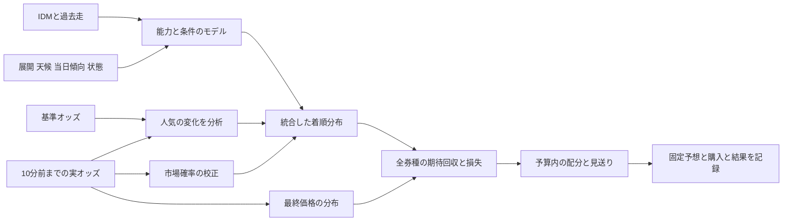

# Race Condition Analyzer 実力と市場評価差の分析仕様

作成日：2026-11-15。対象：藤田さんの個人利用。状態：数理モデルと開発の仕様。これは設計時点の文書で、当初は実装前だった。その後の実装・学習・未対応範囲は [実装確認書](implementation-review.md) を正とする。本書は既存方式を置き換えるための判断基準であり、収益性が確認された法則ではない。

## 1. 到達点

馬の能力を土台に、今回の条件で走れる確率を推定する。その確率と、購入者が付けている価格の差を調べ、発走10分前に判断できる買い目・金額・根拠を出す。

実力順位、人気の過不足、買う価値、購入額を別々に計算する。能力上位でも価格が低ければ見送り、人気馬でも十分な価格なら候補にする。買われ過ぎは購入削減の材料とする。JRA馬券で空売りできる前提は置かない。

能力・市場・統合モデルは Astra で設計を相互検討した。継続的な分析は学習プログラムと記録で行い、会話を続けるだけでモデルが自動学習した扱いにはしない。

### 仕様上の決定

- 能力の初期基準はIDM。市場情報を直接含まないモデルと、市場も使う最終判断モデルを保持する。
- 基準オッズは人気予測として使い、公正価格や勝率として扱わない。
- 取得時刻までの情報だけで予測を作る。最終判断は発走10分前のデータで固定する。
- 設定予算は上限。見送り・一部購入・未使用残額を正式な結果に含める。
- 単一レースの全券種を同じ着順分布で評価する。取得できない価格は「比較不能」と表示する。
- 藤田さんの意見を入れる前のACE予想を固定保存し、意見を反映した案を別に比較する。
- 馬券購入は藤田さんが行う。購入記録は提案記録と区別する。
- 初稿時は仕様作成まで。その後の作成依頼を受けてローカル実装に進んだ。本番反映は別途承認が必要。

## 2. JRDBデータの意味

JRDB公式の説明では、IDMは時計に出遅れ、不利、位置取り、レース内容等を加えた指数。基準オッズは専門紙の印とその影響力、騎手等の人気要因を使った予想オッズ。直前総合にはオッズ点も含まれる。騎手指数にも基準オッズが使われる。[JRDB直前情報ヘルプ](https://jrdb.com/n_live/help.html)

| 系列 | 用途 | 守る区別 |
|---|---|---|
| 今走のKYI予想IDM | 事前の能力基準 | 的中確率ではない |
| 過去走の結果IDM・時計・不利 | 能力の履歴と更新 | 今走終了後の値を今走予想に使わない |
| 距離・馬場・コース・脚質 | 条件による発揮能力の差 | IDMで反映済みの要素を固定加点で二重計上しない |
| TYB・パドック・返し馬 | 当日の状態 | 公開時刻と取得時刻を記録する |
| JRDB基準オッズ | 事前の予想人気 | 実力からの適正オッズではない |
| 実オッズ・時系列 | 購買需要と購入価格の推定 | 投票額の増加を倍率の変化だけで断定しない |
| 着順・通過順・ラップ | 学習の正解、当日傾向 | 判断時点までに確定・取得できた結果だけを使う |
| HJC払戻 | 実際の収支 | 予想入力から分離する |

各項目に `market_derived: yes/no/unknown` を付ける。由来不明の指数を使ったモデルを「市場から独立した純粋能力」と呼ばない。

## 3. 数理設計の全体

学問的な土台は、離散選択モデル、階層ベイズ、確率校正、行動経済学、市場需要の時系列分析、制約付き資金配分。個々の方法が既知でも、日本の対象データで利益につながるかは別に検証する。

## 4. 実力と市場と価格を分ける式

馬iの単勝オッズOは元本込みの倍率とする。出走全馬の、同じ時点の有効オッズが揃った場合だけ次を計算する。

`q_i(t) = (1 / O_i(t)) / Σ_k(1 / O_k(t))`

qは正規化した市場支持率。単勝の通常ケースでは投票シェアの近似になるが、真の勝率ではない。取消、同着、丸め、特殊払戻等では単純関係に誤差が生じる。

`損益分岐勝率 = 1 / O`

`推定回収倍率 = p × O`

`推定純利益率 = p × O − 1`

pは校正を検証した最終モデルの推定勝率。pがqより大きいだけでは購入しない。通常の単勝払戻率は80%で、支持率と損益分岐には差がある。表示オッズには払戻率が織り込まれるので、p×Oから控除率を再度引かない。[JRA払戻計算](https://www.jra.go.jp/faq/pop03/1_17.html?newwindow=true)

以下は別々の架空レースの説明例。確率が正しくオッズが固定された場合の計算である。

| ケース | 推定勝率 | 市場支持率近似 | オッズ | 推定回収率 | 解釈 |
|---|---:|---:|---:|---:|---|
| A | 16% | 10% | 8.0 | 128% | 価格面の候補 |
| B | 12% | 10% | 8.0 | 96% | 市場より高評価でも見送り |
| C | 30% | 40% | 2.0 | 60% | 強くても価格が見合わない |

## 5. 独自設計する市場評価差

能力モデルの条件付き勝率をpF、基準オッズを正規化した予想支持率をqBase、実オッズによる支持率をqNowとする。

`G_i = log(pF_i / qNow_i)`

この評価差は、次のように厳密に分解できる。

`G_i = log(pF_i / qBase_i) + log(qBase_i / qNow_i)`

第1項は「能力モデルと事前に予想されていた人気の差」、第2項は「事前の人気予測と現在の支持率の差」。基準オッズは過去の実測需要ではないので、第2項を実際の資金移動と呼ばない。時間変化は実測snapshot同士で別に計算する。基準オッズがない場合は総差だけ表示し、内訳を創作しない。ゼロや不完全な全頭データは計算対象から外す。

これは既知の対数恒等式をこの用途に組み合わせた説明指標であり、新しい自然法則ではない。値が大きいこと自体は利益の証明にならない。pFの誤り、新情報、入力欠損でも差は生まれる。

### 検証する市場仮説

| 仮説 | 事前に観測する材料 | 採用条件 |
|---|---|---|
| 見た目の着順への過剰反応 | 前走着順とIDM・不利補正の不一致、人気の低下 | 同条件の未使用期間でも市場モデル以上の説明力が残る |
| 条件回復の織り込み不足 | 距離・馬場・コース変更と適性履歴 | 能力と対戦相手の差を調整後も残る |
| 人気要因への過剰反応 | 騎手等の人気要因、基準人気と実人気 | 実際の成績への貢献と人気への貢献の差が再現する |
| 当日傾向への追随の遅れ | 能力調整後の当日傾向、支持率推移 | 少数レースの偶然を考慮後も残る |
| 当日傾向への過剰反応 | 傾向観測後の脚質別人気変化 | 実際の傾向以上に価格が動く状態が再現する |
| 穴馬の過剰人気 | オッズ帯別の支持率と実勝率 | 日本の対象券種・判断時刻で再現する |

海外には穴馬が買われ過ぎるfavorite–longshot biasの研究がある。日本で同じ方向・大きさと仮定せず、検証候補とする。[Snowberg・Wolfers](https://www.nber.org/papers/w15923)

観測データから「ファンの感情」「内部情報」などの原因を断定しない。画面は「この材料と人気の変化が対応した」「この条件で評価差が再現した」と説明する。

## 6. 能力モデルと市場モデルの統合

### 能力モデル pF

IDM単独を比較基準にして、能力履歴、距離・コース・馬場適性、対戦相手、状態、展開の特徴を段階的に追加する。softmaxの温度や各係数を固定の思いつきで決めず、過去期間のレース単位の尤度で推定する。

`pF_i = exp(s_i / T) / Σ_k exp(s_k / T)`

sは予測スコア、Tは確率の広がりを調整する学習値。確率の合計が1になるだけでは校正済みとしない。例えば20%と予測した対象群が未使用期間で約20%勝つかを確認する。温度による校正は既知の手法だが、このデータでの有効性は検証が必要。[Guo et al.](https://proceedings.mlr.press/v70/guo17a.html)

適性は単なる複勝率ではなく、同じ条件で「能力と相手から期待された成績を上回ったか」を基準に推定する。少ない観測は類似条件全体へ縮約し、未経験を不得意と決めつけない。IDMに既に含まれる不利等の補正は、追加特徴の増分が検証できた場合だけ採用する。

### 市場モデル pM

qを過去の実績で校正する。初期比較モデルは以下。

`pM_i = q_i^γ / Σ_k q_k^γ`

γの向き・大きさは過去データで推定する。十分なデータがある範囲で頭数・競馬場・開催条件による差を階層化する。

### 最終判断モデル p*

最初の統合候補は、時系列の別期間で学習した確率の組み合わせ。

`p*_i = exp(α log pF_i + β log pM_i) / Σ_k exp(α log pF_k + β log pM_k)`

能力と市場を組み合わせる発想は既存の競馬研究にもある。学習済みモデルの出力を同じ学習行へ当てて統合係数を決めず、時間順のout-of-fold予測を利用する。[Benter原論文](https://gwern.net/doc/statistics/decision/1994-benter.pdf)

市場仮説の特徴を加える拡張は、校正済み市場を基準にした残差モデルとする。追加効果はゼロ方向へ正則化し、市場単独より悪ければ採用しない。既知市場にない情報を持つ可能性と、能力モデルが単に間違っている可能性を両方比較する。

## 7. 当日の流れと展開

芝とダート、開催場を分離する。能力、頭数、距離、クラス、予想位置取りを考慮した事前確率と、その時点までの結果との差で当日効果を更新する。

例：`P(勝者=i | 当日効果b) ∝ exp(事前スコア_i + b前×前方適性_i + b内×内枠適性_i)`。

当日効果bには類似条件の過去開催から事前分布を置く。少数結果は弱く、多くの整合した結果は強く反映する。強い先行馬が順当に勝っただけで前有利と認定しない。内外の実際のコース取りがない場合は、枠と走行位置の効果を区別する。

展開はスロー・平均・ハイ等の複数シナリオとその推定確率を保持する。各シナリオで脚質や馬同士の競り合いを変え、着順を同時に生成する。シナリオ確率も根拠なく均等や固定値にしない。

高配当が続いた事実は市場予測の不確実性の監視に使う。「荒れた次も荒れる」を自動加点しない。当日効果・価格反応・偶然を分けて検証する。

## 8. 10分前から最終オッズを推定する

基本の観測候補は前日、60・30・20・15・10分前。必須時点の欠損は埋めた実測値にせず、欠損として記録する。券種ごとに提供周期が異なり得るので、取得時刻に加えて表示元の更新時刻を保存する。JRDBには更新周期の公開説明があるが、利用中画面・契約・実際の配信周期は取得実装時に確認する。[JRDBオッズ説明](https://jrdb.com/i/odds_info.html)

単勝で総投票額が取れる場合の需要モデル：

`qFinal_i = a × q10_i + (1 − a) × u_i`

`a = 10分前総投票額 / 最終総投票額`

uは残り時間に入る投票の配分で、各要素は非負、合計1。最終総額とuは未知なので分布として予測する。通常の単勝では `OFinal ≈ 払戻率 / qFinal` と対応するが、正式計算・丸め・取消等を別に処理する。

総投票額がなければaや実流入額を特定したと言わない。支持率の推移から最終支持率の分布を推定する。倍率を直線外挿した一点予想だけで金額を決めない。

現在倍率、変動速度（時間で割る）、変動の急さ、頭数、競馬場、格、券種、基準人気とのズレ等を候補にする。実測履歴が不足する間は「学習済み最終オッズ予測」を表示せず、下落時の感度分析に留める。

## 9. 期待回収率と不確実性

判断時点tの情報をI、買い目jの元本込み実現払戻倍率をRとすると、一般の式は次。Rは不的中で0、全額返還で1、的中時は正式な払戻倍率。

`期待純利益率 e_j = E[R_j | I_t] − 1`

返還がない通常ケースは、的中Aと的中時倍率Dを用いた `E[D_j × 1(A_j) | I_t] − 1` に対応する。複勝・ワイドの払戻は一緒に入る馬にも依存する。同着等は正式ルールに沿う払戻として扱う。勝敗と最終価格が相関する可能性があるので、無条件平均オッズと勝率の積が厳密な式だとしない。[JRA最終オッズと払戻の説明](https://www.jra.go.jp/faq/pop03/1_20.html)

モデルの学習標本やパラメーターを変えた反復推定ごとにeを計算する。保守的評価Lはそのeの分布の下側分位等で定義する。単一レースの払戻分布の下側分位とは別物。単一レースは外れる可能性が高くても期待値が正の場合がある。

`購入候補：保守的期待純利益率 L_j > 必要余裕 m`

mと下側分位の水準は検証用期間で選び、最終テスト前に固定する。「勝率を一律15%引く」等を統計的信頼下限と呼ばない。モデル内の確信度を利益保証として表示しない。

単純な固定価格による説明境界は `購入下限オッズ = (1+m)/p保守`。実際の判断は最終価格の分布と合わせる。架空例でp=16%、O=8なら128%だが、p=14%、O=7に変わると98%。差がどの変化で消えるかを表示する。

## 10. 全券種の比較と金額

単勝、複勝、枠連、馬連、馬単、ワイド、3連複、3連単を単一レースの対象とする。応援馬券は単勝＋複勝として分解する。WIN5は複数レースをまたぐ別機能で、未対応を明示する。

同じ着順シナリオ集合から全券種の的中を計算する。現行Plackett–Luce型を比較基準にし、展開を混合する着順モデルが未使用期間で改善するか確認する。単勝確率を独立に掛けて馬連等の確率を作らない。統合後の着順分布から得る勝率はp*と一致させる。例えば初期方式は `P*(着順列)=p*(1着馬)×P能力モデル(残り着順|1着馬)` とし、2着以下への市場情報の利用は別に検証する。

正式な出走馬・枠・取消を使う。オッズ未取得の組合せは推定価格で実測を代用せず「価格未取得」。比較できた券種と組合せの割合を表示する。

買い目jの金額をx、シナリオsの元本込み払戻倍率をRとする。

`Π_s(x) = Σ_j x_j × (R_sj − 1)`

`x_j ∈ {0, 100, 200, ...}, Σ_j x_j ≤ レース予算`

同一シナリオで全馬券の払戻を合算して、損失確率、利益確率、全不的中確率、期待利益、投資額加重の期待回収率を求める。少なくとも1点当たる確率と、トータルが黒字になる確率を分ける。見送りの回収率は100%とせず「投資なし」、利益0と表示する。

最大損失は有限シミュレーション内の最大損失と区別し、理論上の最悪損失を表示する。全不的中があり得る買い方なら原則として全投入額。全結果を網羅する組合せ等でそれより小さい損失を示す場合は、全ての正式な結果を対象に確認する。

回収率は購入金額を比例拡大しても変わらないため、それだけでは金額を決められない。まず必要な期待回収水準を満たす候補を残し、予算・許容損失・集中の制約内で保守的期待利益を最大化する。その目的値は反復推定bごとのポートフォリオ期待利益 `Σ_j x_j e_j^(b)` の下側分位等として、全体を共同評価する。個別買い目の下限Lを足した値が全体の統計的下限になるとは仮定しない。期待回収率を優先する案と損失を抑える案の比較も出す。

総資金が入力された場合だけ、資産の対数成長を目的とする共同Kelly配分も比較する。レース予算を総資金と置き換えず、各馬券のKelly値を独立計算して足さない。資産成長と回収率最大化は異なる目的である。[制約付きKellyの研究](https://web.stanford.edu/~boyd/papers/kelly.html)

許容損失などの設定がない場合は複数の配分案と損失分布を提示し、未設定の選好を「数学的最適」と断定しない。丸め後に全制約を再計算する。購入額がプールに影響する規模なら固定オッズ近似をやめる。

## 11. 保存する情報

| 記録 | 必須内容 |
|---|---|
| 元データ版 | race_id、horse_id、種別、ファイル版、checksum、公開時刻、観測時刻、取得時刻、取得方法、品質 |
| オッズsnapshot | レース・券種・組合せ・元更新時刻・取得時刻・倍率または上下限・可能なら投票額 |
| 判断snapshot | 判断締切、入力の版と一覧、モデル版、校正版、学習終了日、確率、価格予測、根拠 |
| 提案 | 買い目、予算、未使用金、損失分布、却下理由、比較範囲 |
| 利用者の修正 | 元のACE案、選んだ軸、発言、変更項目、変更後の案、変更時刻 |
| 購入 | 実購入した買い目・金額・時刻。提案通り購入したと自動推定しない |
| 結果と精算 | 確定着順、正式払戻、返還、結果公開時刻、精算版 |
| 学習実験 | 期間、特徴、全試行、採用理由、未使用評価、乱数seed、入力ハッシュ |

入力訂正は追記で版を更新し、過去の判断は再現できる状態にする。観測時刻が不明なら未知として保存し、生成時刻で代用しない。実行時検証では公開時刻と取得時刻の両方が締切以前であることを要求する。履歴復元検証は実際の取得記録による検証と分ける。

ユーザーが買った馬券だけを学習対象にせず、対象レース全頭と見送りを保存する。利用者の意見は条件指定として扱い、正解ラベルは確定結果とする。

## 12. 開発前の実装とデータの確認結果

2026-11-15にコードとローカルDBを読み取り確認した。本番との一致をこの調査だけで保証するものではない。

- `src/WinOddsPage.jsx`：人気順位とIDM順位の差±3で候補判定。確率と価格の大きさを使う方式へ置き換える。
- `src/finalForecast.js`：固定係数によるsoftmax、Plackett–Luce型着順確率。確率15%減、オッズ10〜25%減は統計的校正ではない。
- 同ファイル：取得済み／手入力済み候補から主に1点を選択。全組合せの価格収集・共同配分ではない。
- `src/oddsReview.js`：候補別half-Kelly後に総額調整。新方式では着順ごとの共同損益から配分する。
- 旧比較画面には予想・確定・手入力払戻・JSON出力の保存がある。新最終予想の入力・提案は一時stateで、統合した記録が必要。
- オッズ・当日通過順は主にlocalStorage。更新の履歴、判断時点の再現、学習へ戻す導線を追加する。
- バックエンドDBには5,046レース、70,164出走、79,800結果行がある。連続収録ではなく、例として2026年1〜3月の番組がない。
- 2026年4〜10月の出走21,775行中、レース・馬・日付で結果を結合できたのは13,299行。完全なレース単位で収録率を再監査する。
- KYI予想IDMは保存されているが、結果IDMはDBに保存されていない。現行の過去走IDMも過去のKYI予想値であり、結果IDMと同一視しない。
- 確定単勝オッズはあるが、時刻付き10分前オッズのDB履歴は確認できない。元OZ等の収録時点は未検証。
- HJC取込みは未確認。指定ZIPにはPACI、TYB、HJCの元ファイルがあり、取込み拡張の材料になる。

学習用データが既に十分とは判定しない。確定オッズによる探索結果を、10分前判断で達成できる回収率として表示しない。

## 13. 検証と採用条件

1. レース・出走馬・取消・結果が整合する完全データを抽出する。欠落による選択偏りも報告する。
2. 時間順に学習、校正と閾値選択、未使用テストへ分ける。同じレースの馬やsnapshotを異なる区分へ分けない。
3. q、市場校正pM、IDM単独、能力pF、統合p*を同じ判断時刻で比較する。
4. log loss、レース単位Brier score、勝率帯別校正、上位着順・券種別的中確率の校正を確認する。
5. 購入対象だけの校正も見る。全体で校正されていても「割安に見える馬」だけで外れる偏りを見逃さない。
6. 同じ購入ルールによる実回収率、利益、購入件数、投入額、最大ドローダウン、期間別安定性を比較する。
7. 開催日等の依存を保つブロックbootstrapで区間を出す。多数の条件探索・閾値調整を記録し、最終テストに合わせて選び直さない。
8. 最大の高配当1件を除く、期間・会場を変える、価格を不利にする等の感度を確認する。大穴1件依存を隠さない。
9. 完成した固定モデルで前向きに予想を保存する。収益性の優位が不確かなら「検証中」を続ける。
10. 学習データ追加時に候補モデルを再評価し、採用基準を満たす場合だけ版を更新する。単発的中・不的中で係数を変えない。

新しい条件の追加は「採用すると過去成績が良くなった」だけでは足りない。市場単独を上回る追加情報と、価格を含めた運用成績の両方を評価する。

## 14. 画面の完成条件

レース別の能力、展開・天候、オッズ、最終予想の既存構成を活かす。

最終画面では、馬番・馬名、能力順位、pF、校正済み市場pM、最終p*、実オッズと更新時刻、推定最終オッズの幅、期待回収率と保守的評価、購入下限オッズ、判断を同じ行で比較・並び替えできる。

根拠は「能力」「条件」「展開・当日傾向」「状態」「市場と価格」の順に、根拠データ、判断への寄与、反証条件を表示する。寄与はモデルの説明であり因果効果としない。

上部には「能力の軸」「価格面の候補」「価格が合わない実力馬」「不確実で判定保留」を分けて表示する。下部には買い目、金額、未使用金、期待利益、黒字確率、全不的中確率、最大損失を示す。

取得不足、古いオッズ、ログイン切れ、未学習、対象外条件を区別する。欠損を0や平均の実測値として埋めない。正式全頭の確認が取れなければ購入提案を確定しない。

## 15. 次の開発工程

1. データ監査と入力定義：予想／結果IDMの分離、全頭完全性、公開／取得時刻の導入。
2. 記録基盤：オッズsnapshot、TYB履歴、HJC精算、ACE原案・利用者案・実購入の固定保存。
3. 基準モデル：IDM、市場校正、能力モデル、統合モデルを時間順に検証。
4. 市場評価差：基準人気との分解、仮説の追加価値、下限価格・見送りの表示。
5. 最終価格と全券種：時系列蓄積を用いた価格予測、着順同時分布、共同配分。
6. UI統合と前向き検証：取得→予想固定→手動購入記録→払戻→評価まで通す。

既存の個人PC側Python処理を学習・取込みの土台とし、静的Web画面だけで常時巡回や学習が動く前提を置かない。ブラウザ取得はログイン済みの取得環境が利用可能なときに行う。失敗時は欠損を明示し、手動取込みに切り替えられるようにする。

実装時は認証・RLSを維持し、個人利用データと認証情報を公開しない。Previewまたはローカルで検証後、適用される開発ルールに従って本番反映の段階を分ける。初稿時の成果物はこの仕様のみ。その後の開発結果は実装確認書を参照。
